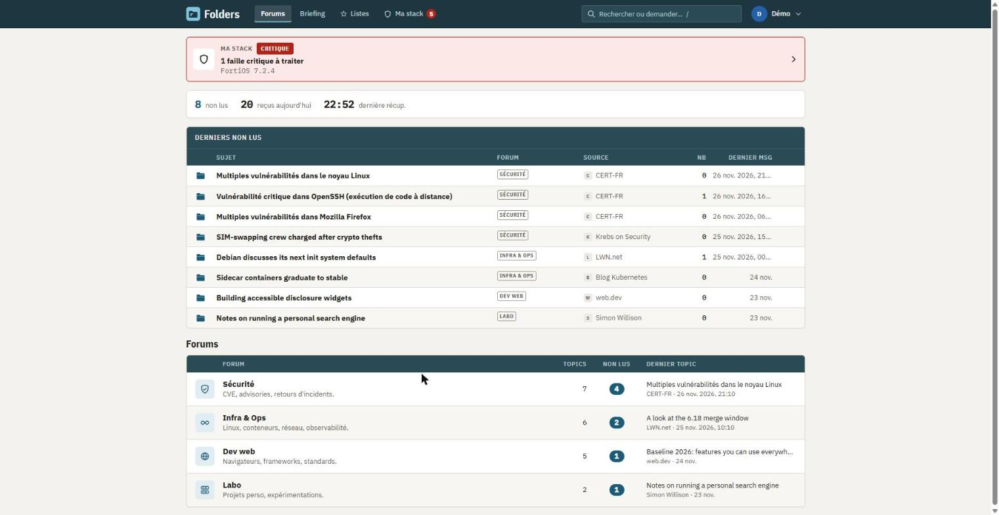
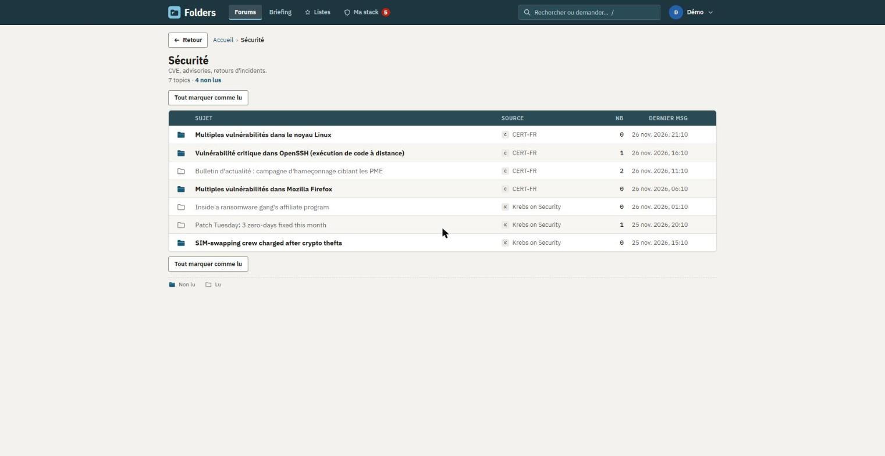
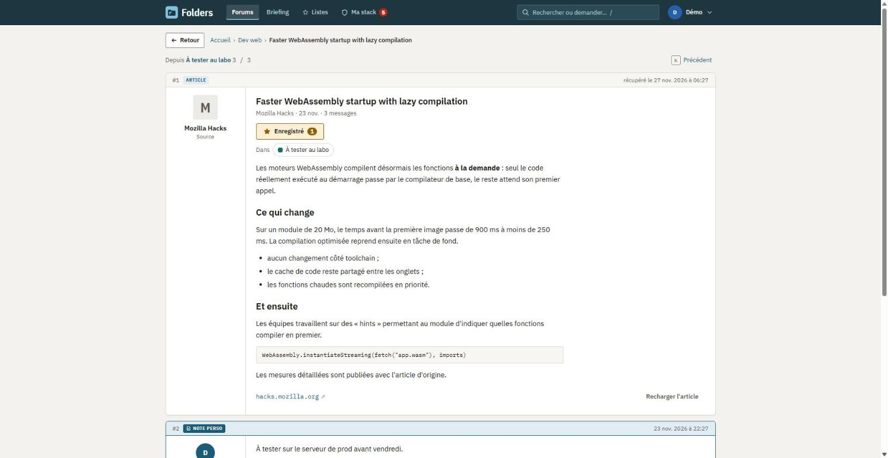
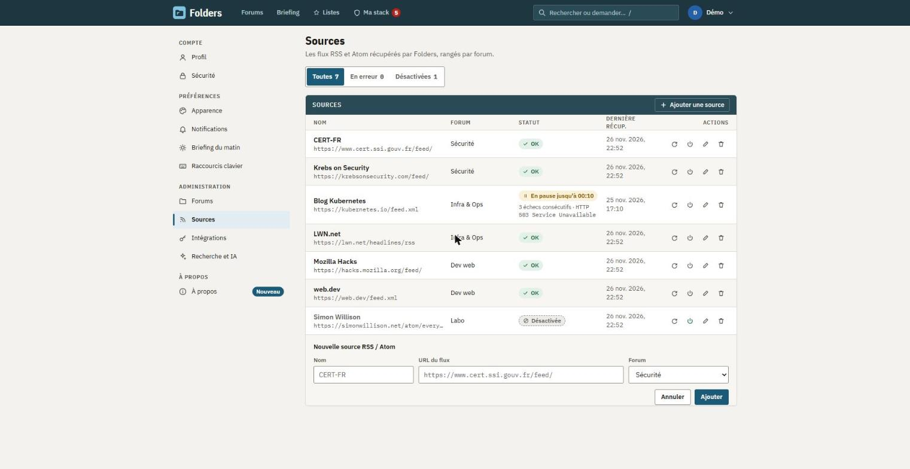
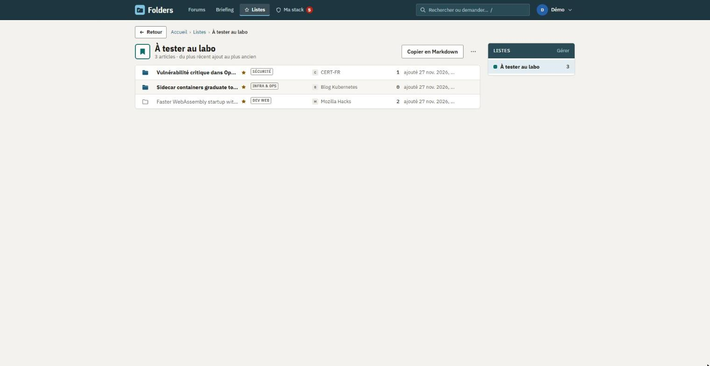
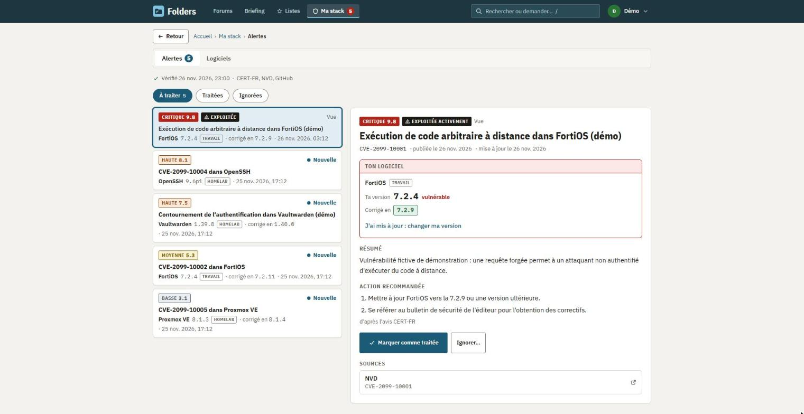
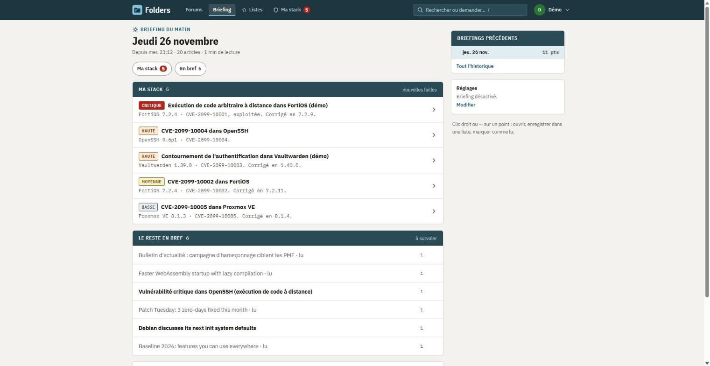
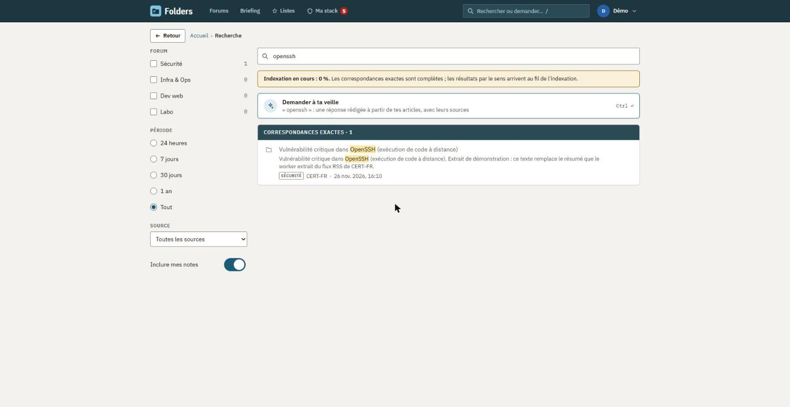
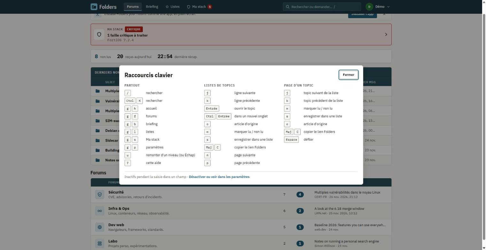
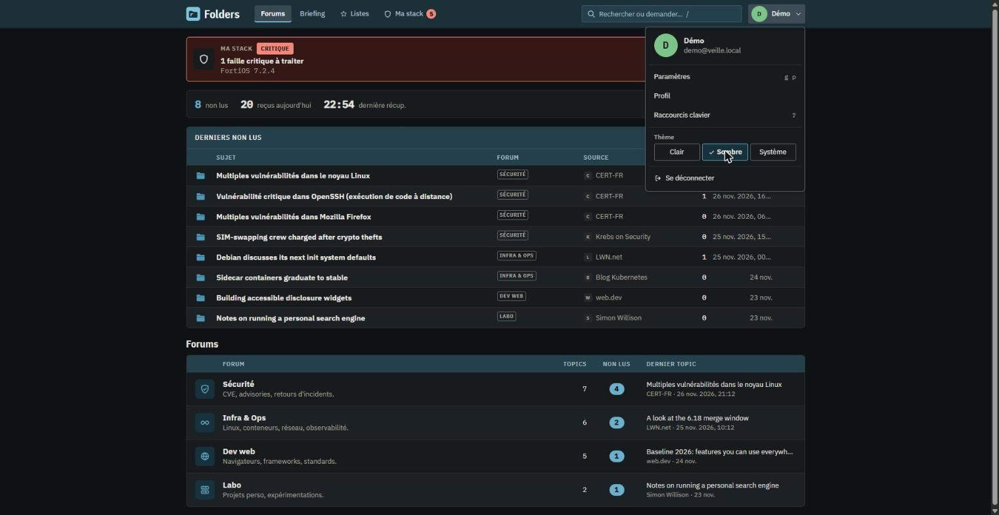

# Folders

[](https://github.com/louisdrouhin/veille/actions/workflows/ci.yml)
[](https://github.com/louisdrouhin/veille/actions/workflows/codeql.yml)
[](LICENSE)

Lecteur de veille technique auto-hébergé, présenté comme un **forum des années 2000**. Chaque source RSS ou Atom
alimente un forum thématique, et chaque article devient un topic qu'on lit dans l'app. Autour de ce forum :

- des notes perso et des listes de favoris ;
- un radar des failles qui touchent tes logiciels ;
- un briefing du matin ;
- une recherche qui répond à partir de tes articles.

Folders est mono-utilisateur. Il tourne chez soi en Docker Compose, derrière un reverse proxy, et s'installe comme
une app sur téléphone.



> **Nom** : l'app s'affiche « Folders ». Le dépôt, le projet Docker Compose (`name: veille`, figé dans
> `docker-compose.yml`), les volumes, la base et les identifiants internes gardent `veille` : renommer le projet
> Compose créerait un nouveau volume, donc une base vide.

*Toutes les captures viennent de la base de démo (`npm run db:seed`) : sources publiques, logiciels et CVE fictifs
(`CVE-2099-…`).*

## Sommaire

- [Fonctionnalités](#fonctionnalités)
- [Stack technique](#stack-technique)
- [Sécurité et vie privée](#sécurité-et-vie-privée)
- [Auto-hébergement](#auto-hébergement)
- [Développement local](#développement-local)
- [Versions](#versions)
- [Licence](#licence)

## Fonctionnalités

### Accueil et « À la une »

- Bandeau **Ma stack** quand une faille est à traiter, puis le résumé chiffré : non lus, reçus aujourd'hui, heure
  de la dernière récupération.
- **À la une** : les sujets repris par au moins 2 sources dans les dernières 48 h.
- **Derniers non lus** de tous les forums. Sur mobile, on en voit 3, et « + N autres non lus » déplie le reste.
- La liste des forums, avec leurs compteurs de non-lus, et une alerte quand des sources sont en erreur.

### Forums, topics et sources

| Liste des topics | Page topic |
|---|---|
|  |  |

- **Liste des topics** :
  - un tableau dense par forum, où un dossier plein signale un non-lu ;
  - tri par dernière activité, pagination, « Tout marquer comme lu » ;
  - menu ⋯ ou clic droit sur une ligne pour ouvrir, enregistrer ou marquer comme lu.
- **Article complet** dans la page topic :
  - le texte vient du flux, ou de la page d'origine extraite avec Readability ;
  - le HTML est assaini (tableaux et code compris) et les images passent par un proxy interne ;
  - le texte est mis en cache, avec « Recharger l'article » à côté du lien source.
- **Notes perso** sous chaque article.
- **Récupération des flux** par un worker séparé, toutes les 15 minutes :
  - ETag et If-Modified-Since ;
  - pause d'une heure après 3 échecs consécutifs ;
  - dédoublonnage par URL normalisée, sans `utm_*`, `fbclid` ni fragment.
- **Fusion des doublons** : un article proche par le sens d'un topic des 72 dernières heures devient une reprise de
  ce topic. Le seuil et la fenêtre se règlent, et « Séparer » annule une fusion.
- **Paramètres › Forums et Sources** :
  - forums réordonnables par glisser-déposer ;
  - sources avec leur statut et leur dernière erreur, filtres « En erreur » et « Désactivées » ;
  - « Récupérer maintenant » ;
  - favicons des sources téléchargés côté serveur.



### Listes de favoris

- **★ Enregistrer** range un topic dans une ou plusieurs listes colorées.
- **Page Listes** : renommer, changer la couleur, réordonner par glisser-déposer, supprimer.
- **Page d'une liste** : tri par date d'ajout, retrait avec « Annuler », « Copier en Markdown ».



- Les articles enregistrés ne sont jamais purgés du cache de lecture, et les pages de listes restent lisibles hors
  ligne.

### Ma stack et alertes CVE



- **Inventaire** : tu déclares tes logiciels et leur version, en contexte Homelab ou Travail.
- **Vérification** : le worker la fait toutes les 30 minutes, en croisant les versions avec :
  - les avis du CERT-FR ;
  - l'API CVE de NVD ;
  - les avis de sécurité et les versions publiées sur GitHub.
- **Comparaison de versions** par schéma : semver, `9.8p1`, `8.0 U2`, builds Windows.
- **Alertes** : une alerte n'est créée que si **ta** version est touchée.
  - Elles sont triées par gravité ; « Exploitée » vient du catalogue CISA KEV ou de l'avis CERT-FR.
  - Le détail est en français : l'avis CERT-FR, ou un résumé Gemini signalé comme tel.
  - Chaque alerte indique la version corrigée, l'action recommandée et le lien vers le topic du même CVE.
  - Actions : « Marquer comme traitée », « Ignorer » (raison au choix, dont « Corrigé par la distribution »).
- **Clés facultatives** :
  - NVD, pour passer de 5 à 50 requêtes / 30 s ;
  - `GITHUB_TOKEN`, pour passer de 60 à 5 000 requêtes / h.

### Briefing du matin



- **Contenu** : à l'heure choisie, Folders prépare une synthèse de ce qui est arrivé depuis la veille, en 4 rubriques
  au choix :
  - **Ma stack** : les nouvelles failles, toujours sans IA ;
  - **À la une** : les sujets repris par plusieurs sources ;
  - **Mes services** : les nouvelles versions des services suivis ;
  - **Le reste en bref** : quelques sujets notables.
- **Réglages** :
  - heure et jours (du lundi au vendredi, ou tous les jours) ;
  - longueur : « Court », sans IA, ou « Détaillé », avec une phrase par point ;
  - aperçu de la notification : complet, ou discret.
- **Horaire** : il suit le fuseau du compte, changement d'heure compris. Un briefing en retard de moins de 3 h est
  rattrapé, au-delà il est sauté.
- **Usage** : « Voir un aperçu d'abord » montre un briefing sans notification. L'historique garde les briefings
  précédents.
- **Activation** : le briefing est désactivé tant qu'on ne l'active pas.

### Notifications push

- Web Push pour les alertes Ma stack et le briefing, iPhone compris (app installée, iOS 16.4 ou plus).
- **Réglages** dans Paramètres › Notifications :
  - gravité minimale ;
  - « toujours si exploitée » ;
  - heures calmes, avec un envoi groupé à leur fin ;
  - mode discret, sans nom de produit.
- La notification du briefing est construite sans IA, et le contexte Travail y reste générique.

### Recherche et IA (Gemini, optionnel)



- **Recherche** (`/recherche`, champ de l'en-tête, `/` ou Ctrl+K) :
  - d'abord les correspondances exactes, notes perso comprises, surlignées ;
  - puis les articles « proches par le sens » ;
  - filtres par forum, période, source et listes, et « Inclure mes notes ».
- **Demander à ta veille** (`/demander`) :
  - la réponse est rédigée **uniquement** à partir d'extraits de tes articles, avec un renvoi `[n]` vérifié côté
    serveur après chaque affirmation ;
  - sans source valide, la réponse est « Rien trouvé dans ta veille » ;
  - l'historique garde les 20 dernières questions, et il est effaçable.
- **Résumer** et **Traduire** dans la page topic :
  - Résumer : 3 à 5 puces, avec « À retenir » quand une action s'impose ;
  - Traduire : traduction à la place de l'article, en gardant images, liens, tableaux et code ;
  - les résultats sont mis en cache et réaffichés sans nouvel appel.
- **Modèles** : `gemini-3.5-flash-lite` pour les résumés, `gemini-3.8-flash` pour les traductions et les questions.
  - Si le modèle principal est surchargé ou trop lent, le résultat vient de Flash-Lite, signalé « Modèle de
    secours », avec « Refaire avec le modèle principal ».
  - Un appel dure au plus 25 s, et une demande au plus 50 s en tout.
- **Paramètres › Recherche et IA** :
  - seuil et fenêtre de fusion des doublons ;
  - limites par jour : textes indexés (1 000) et questions (50) ;
  - simulation des réglages sur tes articles ;
  - avancement de l'indexation.
- Sans clé Gemini, tout ce qui précède est désactivé ou masqué, sauf la recherche exacte, qui reste locale.

### Raccourcis clavier



- **Partout** :
  - `/` ou `Ctrl K` : rechercher ;
  - `g` puis `h` / `f` / `b` / `l` / `s` / `p` : aller à l'accueil, aux forums, au briefing, aux listes, à Ma
    stack, aux paramètres ;
  - `u` ou `Échap` : remonter d'un niveau ;
  - `?` : l'aide.
- **Listes de topics** :
  - `j` / `k` : ligne suivante / précédente ;
  - `Entrée` : ouvrir, `Ctrl Entrée` dans un nouvel onglet ;
  - `o` : article d'origine ;
  - `m` : marquer lu / non lu ;
  - `s` : enregistrer dans une liste ;
  - `Maj C` : copier le lien Folders ;
  - `n` / `p` : page suivante / précédente.
- **Page d'un topic** :
  - `j` / `k` : topic suivant / précédent de la liste d'origine (le topic ouvert passe en lu) ;
  - `Espace` : défiler.

Les raccourcis sont inactifs pendant la saisie dans un champ. Paramètres › Raccourcis clavier permet de les
désactiver.

### Compte, apparence et paramètres



- **Menu du compte** (en-tête) : Paramètres, Profil, Raccourcis clavier, thème (Clair / Sombre / Système),
  déconnexion.
- **Mode sombre** : il suit l'appareil, ou il est forcé. Le rendu est fait côté serveur, sans flash ni script.
- **Paramètres** (`/parametres/…`) : Profil, Sécurité, Apparence, Notifications, Briefing du matin, Raccourcis
  clavier, Forums, Sources, Intégrations, Recherche et IA, À propos.
  - Les anciennes adresses `/compte` et `/admin` redirigent vers leur page.
  - À propos affiche la version, le commit, la date du build et les nouveautés.
- **Profil** :
  - prénom, nom et adresse e-mail ;
  - photo recadrée dans le navigateur, puis contrôlée par le serveur (voir [Sécurité](#sécurité-et-vie-privée)).
- **Sécurité** :
  - changement du mot de passe ;
  - double authentification TOTP : QR code, codes de secours, appareil de confiance 30 jours ;
  - sessions ouvertes, révocables une par une ou toutes sauf la session en cours.

### App installable (PWA)

- **Installation** : sur iPhone, Partager › Sur l'écran d'accueil ; sur Android et ordinateur, le bouton
  « Installer l'app ». Il faut du HTTPS, ou `localhost`.
- **Hors ligne** :
  - les pages déjà vues restent lisibles : accueil, forums, topics ouverts (article et images), listes, Ma stack ;
  - ailleurs, une page « Hors ligne » liste ce qui est disponible ;
  - les actions demandent le réseau.
- **Dans l'app installée** :
  - « tirer pour rafraîchir » et un bouton « Actualiser » (iOS n'en a pas en mode app) ;
  - un avis « Nouvelle version disponible » après un déploiement, sans rechargement forcé ;
  - les liens externes s'ouvrent dans le navigateur.

## Stack technique

| | |
|---|---|
| App | Next.js 16 (App Router, server actions, `proxy.ts`), React 19, TypeScript strict |
| UI | Tailwind CSS v4 (design tokens, aucune couleur en dur), polices IBM Plex auto-hébergées |
| Données | PostgreSQL 17, Drizzle ORM (migrations versionnées dans `drizzle/`) ; embeddings en `bytea`, sans pgvector |
| Auth | Better Auth (email + mot de passe, inscription désactivée, TOTP) |
| Worker | Process Node séparé (`rss-parser`), même base de code : flux, Ma stack, indexation, briefing |
| Lecture | `@mozilla/readability` sur un DOM `linkedom`, `sanitize-html` |
| IA | API Gemini appelée côté serveur (`fetch`), sans SDK ; Web Push avec `node:crypto`, sans dépendance |
| Tests | Vitest, PGlite en mémoire ; testcontainers (PostgreSQL réel) pour l'intégration |
| Déploiement | Image Docker (Next `standalone`, utilisateur non-root) publiée sur GHCR, Docker Compose |
| CI | GitHub Actions (lint, typecheck, tests, intégration, `npm audit`), CodeQL, scan Trivy de l'image, Dependabot ; actions épinglées par SHA |

## Sécurité et vie privée

L'app affiche du HTML venu de sites tiers et télécharge des URL qu'elle ne contrôle pas : la sécurité a guidé la
conception. Une faille ? Voir [SECURITY.md](SECURITY.md).

### Anti-SSRF

`lib/net/safe-fetch.ts` porte toutes les requêtes sortantes déclenchées par du contenu tiers : articles, favicons,
proxy d'images, sources Ma stack, envoi des notifications.

- Seuls `http` et `https` sont acceptés.
- Toute adresse privée, loopback, link-local ou réservée est refusée, en IPv4 comme en IPv6, IPv4 mappée comprise.
- La socket utilise un `lookup` filtré : il n'y a pas de fenêtre de DNS rebinding.
- Les redirections (3 au plus) sont revérifiées à chaque saut, et la taille maximale est appliquée pendant le
  téléchargement.

### CSP avec nonce

`lib/csp.ts`, posée par `proxy.ts` sur chaque page, avec un nonce par requête :

- `script-src 'nonce-…' 'strict-dynamic'` : aucun script inline ;
- `img-src 'self'` et `connect-src 'self'` ;
- `object-src`, `frame-src` et `media-src` à `'none'`, `frame-ancestors 'none'`, `form-action 'self'`.

### HTML assaini

`lib/reader/sanitize.ts` fait l'assainissement côté serveur, avant le stockage.

- Liste blanche stricte de balises et d'attributs : ni `on*`, ni `style`.
- Les liens externes reçoivent `rel="noopener noreferrer"`.
- L'extraction tourne sur `linkedom`, qui n'exécute aucun script.

### Proxy d'images

Les images des articles sont réécrites vers `/api/image-proxy`, et le navigateur ne contacte jamais le site tiers.

- Une session est requise.
- Le type est identifié par les octets, et le SVG est refusé.
- La taille est limitée.

### Authentification

- **Comptes** : Better Auth, inscription désactivée, mots de passe d'au moins 12 caractères, cookies `Secure` en
  HTTPS.
- **2FA** : TOTP optionnelle, secret chiffré en base, codes de secours à usage unique.
- **Rate limiting** : 3 tentatives par 10 s et par client, sur la connexion et sur le second facteur. Le client est
  identifié par `X-Forwarded-For`, lu par la droite avec `TRUSTED_PROXIES`.
- **Sessions** : chaque layout, route API et server action revérifie la session. `proxy.ts` ne fait qu'une
  redirection de confort (cf. CVE-2025-29927).
- **Premier lancement** : `/setup` est protégé par un verrou consultatif PostgreSQL, si bien qu'un seul compte peut
  être créé. Ensuite, `/setup` renvoie 404.
- **Re-confirmation** : modifier les clés d'API, le mot de passe, la 2FA ou l'e-mail demande le mot de passe, ou le
  code 2FA. La confirmation vaut 10 minutes dans cette session, avec 5 essais par 10 minutes.

### Clés chiffrées

Les clés saisies dans Paramètres › Intégrations sont chiffrées en AES-256-GCM avec `SECRETS_KEY`.

- Le chiffrement utilise un IV aléatoire et le nom de la clé en donnée associée.
- Une clé n'est jamais renvoyée au navigateur : seuls ses 4 derniers caractères sont affichés.
- Une clé n'apparaît jamais dans les journaux.
- Le journal `settings_log` dit qui a changé quoi, et quand, sans les valeurs.

### Photo de profil

- Elle est recadrée et ré-encodée dans le navigateur, sur un canvas.
- Le serveur vérifie :
  - le vrai format (JPEG ou WebP) ;
  - l'absence de métadonnées EXIF, XMP, IPTC ou commentaires ;
  - les dimensions exactes, 512 × 512 et 64 × 64.
- Elle est servie en `nosniff` et en cache privé.

### Service worker

- Il ne met en cache que des `GET` de notre origine, et seulement les pages prévues pour le hors-ligne.
- Il ne met jamais en cache :
  - `/api/auth`, `/setup`, `/parametres`, `/login`, ni les server actions ;
  - une redirection ou une erreur.
- Ses caches sont vidés à la déconnexion.

### Vie privée et IA

- Rien n'est envoyé à Gemini sans geste explicite : un clic sur Résumer, Traduire ou Demander, ou l'activation du
  briefing détaillé. Une URL de question partagée ou rechargée redemande avant d'envoyer.
- L'indexation par le sens envoie le titre, le chapô et le début des articles publics.
- Les **notes perso** et l'inventaire **Ma stack** ne partent **jamais** à Gemini : ni en embeddings, ni dans une
  question, ni dans le briefing.
- Les journaux de Ma stack ne contiennent que des nombres et des noms de sources : jamais un produit, une version ni
  un CVE. Les services interrogés (NVD, GitHub) voient en revanche quels produits sont suivis.
- Offre gratuite de Gemini : Google peut utiliser les textes envoyés (des articles publics) pour améliorer ses
  produits.

## Auto-hébergement

Prérequis : Docker avec le plugin Compose, et un reverse proxy HTTPS devant l'app.

### docker compose

```sh
git clone https://github.com/louisdrouhin/veille.git
cd veille
cp .env.example .env      # puis le remplir, voir ci-dessous
docker compose pull
docker compose up -d
curl http://localhost:3000/api/health     # {"status":"ok",…} une fois le premier cycle du worker terminé
```

Quatre services :

- `db` : PostgreSQL 17, dans le volume `db-data` ;
- `app` : applique les migrations au démarrage, puis sert Next ;
- `worker` : démarre une fois `app` healthy ;
- `backup` : les sauvegardes.

Les logs Docker sont limités à 3 × 10 Mo par service.

L'image `ghcr.io/louisdrouhin/veille` (linux/amd64, publique) est construite par la CI à chaque nouvelle version.

- Elle est analysée par Trivy : une faille CRITIQUE corrigeable bloque la publication.
- Elle est publiée avec sa provenance et son SBOM, sous les tags `X.Y.Z`, `X.Y`, commit court et `latest`.

Pour construire l'image soi-même (fork, développement) :
`APP_VERSION=local APP_COMMIT=$(git rev-parse --short HEAD) docker compose -f docker-compose.yml -f docker-compose.build.yml up -d --build`.

### Variables du `.env`

Toutes sont décrites dans [`.env.example`](.env.example).

| Variable | Rôle |
|---|---|
| `APP_VERSION` | **Obligatoire.** Version de l'image à lancer (voir les [Releases](https://github.com/louisdrouhin/veille/releases)) |
| `POSTGRES_PASSWORD` | **Obligatoire.** Ex. `openssl rand -base64 24` (`POSTGRES_USER` / `POSTGRES_DB` : `veille`) |
| `BETTER_AUTH_SECRET` | **Obligatoire.** Au moins 32 caractères aléatoires, ex. `openssl rand -base64 32` |
| `BETTER_AUTH_URL` | URL publique exacte de l'app, telle que la voit le navigateur |
| `TRUSTED_PROXIES` | IP du reverse proxy (`/32`), pour un rate limiting par client exact |
| `APP_PORT` / `APP_BIND` | Port publié (`APP_BIND=127.0.0.1` si le proxy est sur la même machine) |
| `SECRETS_KEY` | Clé maîtresse des clés saisies dans Paramètres › Intégrations (`openssl rand -base64 32`) |
| `GEMINI_API_KEY`, `GEMINI_MODEL`, `GEMINI_TRANSLATE_MODEL`, `GEMINI_EMBEDDING_MODEL` | IA (optionnel) |
| `EMBED_DAILY_LIMIT`, `ASK_DAILY_LIMIT` | Limites par jour de l'indexation et des questions |
| `NVD_API_KEY`, `GITHUB_TOKEN`, `STACK_CHECK_INTERVAL_MINUTES` | Ma stack |
| `VAPID_PUBLIC_KEY`, `VAPID_PRIVATE_KEY`, `VAPID_SUBJECT` | Notifications push (optionnel) |
| `FETCH_INTERVAL_MINUTES`, `FETCH_CONCURRENCY`, `FETCH_USER_AGENT` | Worker de récupération |
| `DATABASE_POOL_SIZE`, `EMBED_PER_CYCLE`, `MERGE_THRESHOLD`, `MERGE_WINDOW_HOURS`, `SEARCH_SEMANTIC_MIN`, `ASK_SEMANTIC_MIN`, `RELATED_MIN` | Réglages fins (optionnels) : vides, ce sont les valeurs par défaut de l'app (voir `.env.example`) |
| `BACKUP_HOUR`, `BACKUP_KEEP`, `BACKUP_UID`, `BACKUP_GID` | Sauvegardes |

- **Clés dans l'interface** : Paramètres › Intégrations gère les clés Gemini, NVD et VAPID sans toucher au `.env`,
  à condition que `SECRETS_KEY` soit défini.
  - Une valeur saisie dans l'interface remplace celle du `.env`.
  - « Tester la clé » fait l'appel le plus petit possible.
  - « Générer les clés » crée les clés VAPID côté serveur.
- **Clés VAPID en ligne de commande** :
  `docker compose run --rm --no-deps app node dist/vapid-keys.js`, puis les deux lignes affichées dans le `.env`.
  Ne plus les changer ensuite : chaque appareil abonné devrait se réabonner.

> Le port de l'app ne doit être joignable que par le reverse proxy (`APP_BIND`, pare-feu). En accès direct, un client
> peut forger `X-Forwarded-For` et contourner le rate limiting de la connexion.

### Premier lancement : `/setup`

Tant qu'aucun compte n'existe, toutes les pages redirigent vers **`/setup`** : email, mot de passe (au moins
12 caractères) et confirmation. Une fois le compte créé, `/setup` renvoie 404.

> ⚠️ Tant que le setup n'est pas fait, quiconque atteint l'app peut le faire. Crée le compte **avant** d'exposer
> l'app via le reverse proxy, ou en ligne de commande :

```sh
docker compose exec app node dist/create-user.js --email moi@example.com --password 'un long mot de passe' --name Moi
# Mot de passe oublié : change le mot de passe et ferme toutes les sessions (--disable-2fa : coupe aussi la 2FA)
docker compose exec app node dist/reset-password.js --email moi@example.com --password 'un nouveau mot de passe'
```

Ensuite :

1. Crée des forums et des sources dans **Paramètres › Forums** et **Sources**.
2. Clique sur « Récupérer maintenant », ou attends le worker (toutes les `FETCH_INTERVAL_MINUTES`, 15 par défaut).

### Reverse proxy et `TRUSTED_PROXIES`

Le reverse proxy doit transmettre l'en-tête `Host` d'origine (ou `X-Forwarded-Host`), sinon Next refuse les server
actions (protection CSRF). Il ne doit pas non plus croire un `X-Real-IP` envoyé par le client.

**Exemple avec Nginx Proxy Manager** (NPM) en Docker sur la même machine. L'app rejoint le réseau de NPM et ne
publie aucun port.

1. **Réseau** :
   - copier [`docker-compose.npm.example.yml`](docker-compose.npm.example.yml) en `docker-compose.override.yml`
     (non versionné) ;
   - y mettre le nom du réseau de NPM (`docker network ls`), puis lancer `docker compose up -d` ;
   - l'app y est joignable sous l'alias `veille-app`, qu'aucun autre conteneur du réseau ne doit utiliser.
2. **`TRUSTED_PROXIES`** dans `.env` : l'IP de NPM sur ce réseau, en `/32`, obtenue avec
   `docker inspect <conteneur npm> -f '{{range .NetworkSettings.Networks}}{{.IPAddress}} {{end}}'`.
   Ne pas y mettre tout le sous-réseau : la passerelle Docker (`.1`) relaie certaines connexions, et la croire ferait
   lire au rate limiting une valeur forgée.
3. **Dans NPM**, Proxy Hosts › l'hôte de l'app :
   - *Details* : scheme `http`, Forward Hostname `veille-app`, Forward Port `3000` ;
   - *Advanced* :

     ```nginx
     set_real_ip_from 127.0.0.1/32;
     real_ip_recursive off;
     ```

     Sans ces deux lignes, la configuration globale de NPM croit le `X-Real-IP` d'un client du LAN ou d'Internet
     (via le NAT), ce qui contourne le rate limiting. À retirer si un CDN est placé devant NPM.
   - Enregistrer *Details* et *Advanced* **ensemble** : chaque enregistrement réécrit tout l'hôte.

**Contrôle** : sur 6 tentatives, les 3 premières renvoient 401, les suivantes 429.

```sh
U=https://veille.example.org
for i in 1 2 3 4 5 6; do
  curl -s -o /dev/null -w '%{http_code} ' -X POST "$U/api/auth/sign-in/email" \
    -H 'content-type: application/json' -H "origin: $U" \
    -H "X-Real-IP: 198.51.100.$i" -H "X-Forwarded-For: 203.0.113.$i" \
    -d '{"email":"sonde@example.com","password":"mauvais-mot-de-passe"}'
done
```

### Supervision

`GET /api/health` est non authentifié et ne renvoie aucune donnée utilisateur :

```json
{"status":"ok","db":"ok","worker":{"status":"ok","lastCycleAt":"2026-11-23T09:13:44.171Z","intervalMinutes":15,"staleAfterMinutes":45}}
```

Il répond **503** dans deux cas, ce qui permet à une sonde (Uptime Kuma…) de détecter un worker planté :

- la base est injoignable ;
- le worker n'a terminé aucun cycle depuis plus de 3 fois son intervalle (`stale`, ou `never` s'il n'a jamais tourné).

Le healthcheck Docker de `app` utilise `/api/health/app`, qui ne vérifie que la base.

### Mise à jour et retour arrière

1. Lire les notes de la [Release](https://github.com/louisdrouhin/veille/releases).
2. Si la version contient une migration (nouveau fichier dans `drizzle/`), faire d'abord une sauvegarde :

   ```sh
   docker compose exec -T db pg_dump -U veille -d veille -Fc > backups/avant-X.Y.Z.dump
   ```

3. `git pull`, pour avoir le fichier compose à jour.
4. Mettre la nouvelle version dans `.env` : `APP_VERSION=X.Y.Z`.
5. `docker compose pull && docker compose up -d`, puis vérifier `/api/health` et la version dans Paramètres ›
   À propos.

**Retour arrière** : remettre l'ancienne `APP_VERSION`, puis `docker compose pull && docker compose up -d`. Les
migrations ne sont pas annulées : après une version qui en contenait, restaurer aussi la sauvegarde.

### Sauvegarde et restauration

Le service `backup` fait chaque jour un `pg_dump` au format custom (compressé), à partir de 3 h, heure de Paris
(`BACKUP_HOUR`).

- **Fichiers** : `./backups/veille-AAAA-MM-JJ_HHMM.dump`, en mode 600, appartenant à `BACKUP_UID`:`BACKUP_GID`.
- **Rétention** : les 7 plus récents (`BACKUP_KEEP`). Seuls les dumps réussis comptent, et un dump raté ne
  remplace jamais un bon.
- **Rattrapage** : la vérification a lieu toutes les 10 minutes, et un jour manqué est rattrapé. Un premier dump est
  fait dès le démarrage.
- **Santé** : le conteneur devient `unhealthy` si le dernier dump a plus de 26 h.

```sh
ls -lh backups/                                                     # sauvegardes disponibles
docker compose logs backup                                          # dernières exécutions
docker compose exec backup sh /usr/local/bin/veille-backup.sh once  # sauvegarde immédiate
```

> Les dumps restent sur la même machine que la base : copie-les régulièrement ailleurs.

**Restauration** (remplace tout le contenu de la base ; avec `--single-transaction`, une erreur ne modifie rien) :

```sh
F=backups/veille-2026-11-23_0300.dump
docker compose stop app worker
docker compose exec -T db pg_restore -U veille -d veille --clean --if-exists --no-owner --single-transaction --exit-on-error < "$F"
docker compose start app worker
curl -s http://localhost:3000/api/health
```

Pour vérifier un dump sans toucher à la base, le restaurer dans une base jetable :

```sh
docker compose exec db createdb -U veille veille_verif
docker compose exec -T db pg_restore -U veille -d veille_verif --no-owner --exit-on-error < "$F"
docker compose exec db psql -U veille -d veille_verif -c 'select count(*) from topics'
docker compose exec db dropdb -U veille veille_verif
```

## Développement local

Il faut Node.js 22.19 ou plus.

```sh
npm install
cp .env.example .env
npm run db:dev        # PostgreSQL embarqué (PGlite, données dans .pglite/) sur localhost:5432
```

Dans `.env`, régler `DATABASE_URL=postgres://postgres@localhost:5432/postgres` et
`BETTER_AUTH_URL=http://localhost:3000`. Puis, dans un autre terminal :

```sh
npm run db:migrate
npm run db:seed       # base de démo ; compte demo@veille.local / demo-veille-2026
npm run dev           # http://localhost:3000
npm run worker        # optionnel, dans un autre terminal (--once pour un seul cycle)
```

La base de démo contient 4 forums, 7 sources publiques, 20 topics (dont un article complet), des notes, une liste de
favoris, et des logiciels et CVE fictifs dans Ma stack.

On peut aussi utiliser un vrai PostgreSQL :
`docker compose -f docker-compose.yml -f docker-compose.dev.yml up -d db`.

| Commande | Rôle |
|---|---|
| `npm test` | Tests unitaires (Vitest, PGlite en mémoire) |
| `npm run test:integration` | Après `npm run build` : setup concurrent et app réelle en HTTP, workers concurrents sur un vrai PostgreSQL (testcontainers, ou `TEST_DATABASE_URL`) |
| `npm run lint` | ESLint (config Next + règles React Compiler) |
| `npm run typecheck` | TypeScript strict |
| `npm run db:generate` | Génère une migration après une modification de `lib/db/schema.ts` |
| `npm run build` | Build Next standalone + `dist/{worker,migrate,create-user,reset-password,vapid-keys}.js` |
| `npm run create-user` / `npm run reset-password` | Mêmes scripts qu'en production, hors Docker |

## Versions

- [`CHANGELOG.md`](CHANGELOG.md) : les nouveautés de chaque version, côté utilisateur. On les retrouve aussi dans
  Paramètres › À propos.
- [`docs/design/`](docs/design/) : les notes de design de chaque lot (`HANDOFF-<version>.md`) et les design tokens.
  [`docs/design/README.md`](docs/design/README.md) fait la correspondance avec les versions de l'app.
- [`docs/SPEC.md`](docs/SPEC.md) : la spécification d'origine (v1) et sa feuille de route.

## Licence

[MIT](LICENSE). Polices IBM Plex sous licence SIL OFL 1.1 (`app/fonts/OFL-*.txt`).
