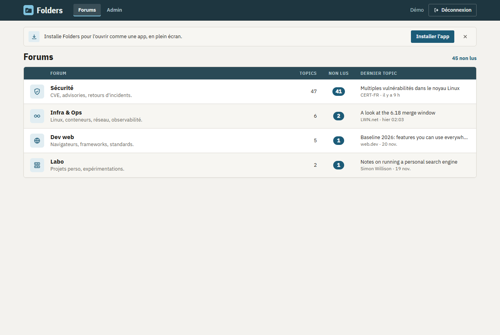
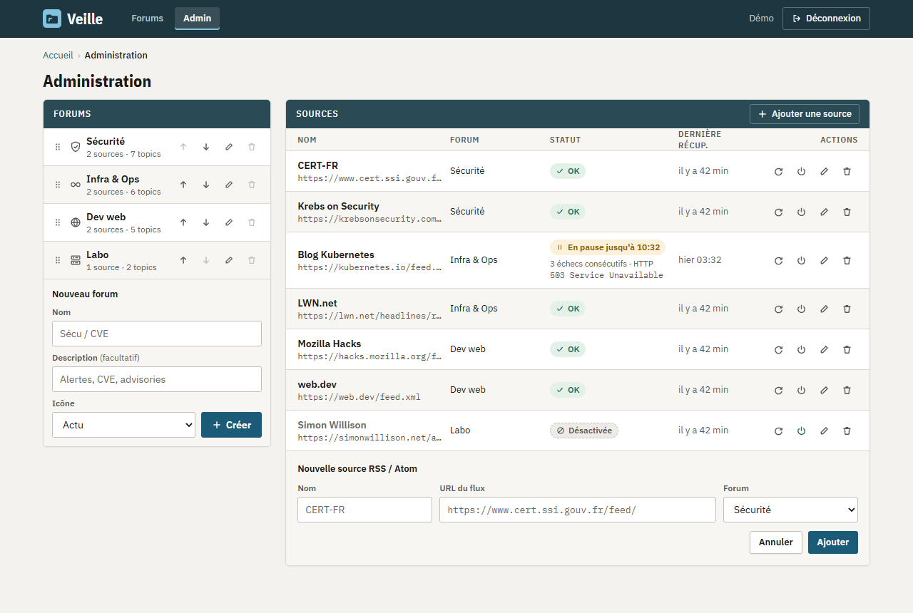

# Folders

[](https://github.com/louisdrouhin/veille/actions/workflows/ci.yml)
[](https://github.com/louisdrouhin/veille/actions/workflows/codeql.yml)
[](LICENSE)

Agrégateur de veille technique auto-hébergé, présenté comme un **forum des années 2000** : chaque source RSS / Atom
alimente un forum thématique, chaque article devient un topic, et on le lit directement dans l'app.
Application mono-utilisateur, pensée pour tourner chez soi en Docker Compose derrière un reverse proxy.



> **Nom** : l'app s'affiche « Folders ». Le dépôt, le dossier de déploiement, le projet Docker Compose (`name: veille`,
> figé dans `docker-compose.yml`), les volumes (`veille_db-data`), la base et les identifiants internes gardent
> `veille` : renommer le projet Compose créerait un nouveau volume, donc une base vide.

| Liste des topics | Page topic |
|---|---|
|  |  |



*Captures réalisées sur la base de démo (`npm run db:seed`).*

## Fonctionnalités

- **Accueil** : résumé chiffré (non lus, reçus aujourd'hui, dernière récupération), alerte des sources en erreur,
  derniers non lus de tous les forums, puis la liste des forums.
- **Forums et topics** : un tableau dense par forum (dossier plein = non lu), tri par dernière activité, pagination,
  « Tout marquer comme lu », compteurs de non-lus sur l'accueil.
- **Récupération des flux** par un worker séparé : ETag / If-Modified-Since, timeout, mise en pause automatique d'une
  source après 3 échecs, dédoublonnage par URL normalisée (sans `utm_*`, `fbclid`, fragment…).
- **Article complet** dans la page topic, depuis le contenu du flux ou extrait de la page d'origine
  avec Readability, HTML assaini (tableaux compris), images servies par un proxy interne. Cache et ré-extraction à la demande.
- **Résumé et traduction par IA** (Gemini, optionnel) : dans la barre d'actions du topic, « Résumer » en
  3 à 5 puces au-dessus de l'article (avec « À retenir » quand il y a une action à faire), « Traduire » à la place
  de l'article (« Original ») en gardant images, liens, tableaux et code, à la demande, mis en cache et réaffiché
  sans appel sur tous les appareils.
- **Notes perso** sur chaque topic.
- **Listes de favoris** : ★ Enregistrer sur un topic, dans une ou plusieurs listes colorées, avec un repère ★ dans
  les listes de topics. Pages « Listes » (renommer, couleur, ordre par glisser-déposer, suppression) et une page par
  liste (tri par date d'ajout, retrait avec « Annuler », « Copier en Markdown »). Les articles enregistrés ne sont jamais
  purgés du cache de lecture, et les pages de listes sont gardées pour la lecture hors ligne.
- **Navigation** : bouton « ← Retour » et fil d'Ariane sur chaque page ; retour à la même page et au même défilement
  de la liste quand on vient d'un topic ; raccourcis **Échap** ou **U** pour remonter d'un niveau.
- **Mode sombre** qui suit l'appareil, ou forcé clair / sombre depuis « Mon compte › Apparence » (réglage du
  compte, rendu côté serveur sans flash ni script).
- **Double authentification (TOTP)** optionnelle, depuis « Mon compte » : QR code, codes de secours, appareil de confiance 30 jours.
- **Administration** : forums réordonnables par glisser-déposer, sources avec statut et dernière erreur,
  « Récupérer maintenant ».
- **Favicons des sources** téléchargés côté serveur, avec repli sur l'initiale.
- **Premier lancement guidé** (`/setup`) et scripts de création de compte et de récupération de mot de passe.
- **Supervision** : `/api/health` signale une base injoignable ou un worker arrêté (pour Uptime Kuma & co).
- **Sauvegardes** : `pg_dump` quotidien avec rétention de 7 jours, procédure de restauration testée.
- **App installable (PWA)** sur iPhone, Android et ordinateur : plein écran, lecture hors ligne des topics déjà
  ouverts (article et images compris), bouton « Actualiser » et « tirer pour rafraîchir » dans l'app installée
  (iOS n'en a pas en mode app), avis de nouvelle version.

## Stack

| | |
|---|---|
| App | Next.js 16 (App Router, server actions, `proxy.ts`), React 19, TypeScript strict |
| UI | Tailwind CSS v4 (design tokens, aucune couleur en dur), polices IBM Plex auto-hébergées |
| Données | PostgreSQL 17, Drizzle ORM (migrations versionnées) |
| Auth | Better Auth (email + mot de passe, inscription désactivée) |
| Worker | Process Node séparé (`rss-parser`), même base de code |
| Lecture | `@mozilla/readability` sur un DOM `linkedom`, `sanitize-html` |
| Tests | Vitest, PGlite en mémoire, testcontainers (PostgreSQL réel) pour l'intégration |
| Déploiement | Docker (build Next `standalone`, utilisateur non-root), Docker Compose |
| CI | GitHub Actions (lint, typecheck, tests, intégration, `npm audit`), CodeQL, Dependabot ; actions épinglées par SHA |

## Choix de sécurité

L'app affiche du HTML venu de sites tiers et télécharge des URL qu'elle ne contrôle pas : la sécurité a guidé la
conception.

- **SSRF** (`lib/net/safe-fetch.ts`) : toutes les requêtes sortantes déclenchées par du contenu tiers (articles,
  favicons, proxy d'images) passent par `safeFetch`. Seuls `http` et `https` sont acceptés ; le nom est résolu et
  toute adresse privée, loopback, link-local ou réservée est refusée (10/8, 172.16/12, 192.168/16, 127/8,
  169.254/16, 100.64/10, `::1`, `fc00::/7`, `fe80::/10`, IPv4 mappée…). La socket elle-même utilise un `lookup`
  filtré, donc pas de fenêtre de DNS rebinding entre la vérification et la connexion. Redirections suivies à la main
  (3 au maximum) et revérifiées à chaque saut ; taille maximale appliquée pendant le téléchargement.
- **Assainissement HTML** (`lib/reader/sanitize.ts`) : liste blanche stricte de balises (`p`, `h2`-`h4`, listes,
  `a`, `strong`, `em`, `blockquote`, `pre`/`code`, `img`, `figure`) et d'attributs (`a[href]`, `img[src|alt]`
  seulement : ni `on*`, ni `style`) ; liens externes en `rel="noopener noreferrer"`. Fait côté serveur, avant stockage.
  L'extraction tourne sur `linkedom`, qui n'exécute aucun script.
- **Images** : réécrites vers `/api/image-proxy` (session requise), types identifiés par leurs octets (SVG refusé),
  taille limitée. Le navigateur ne contacte jamais le site tiers.
- **CSP** (`lib/csp.ts`, posée par `proxy.ts` sur chaque page) : scripts `'nonce-…' 'strict-dynamic'` avec un nonce
  par requête, `img-src 'self'`, `object-src`, `frame-src` et `media-src` à `'none'`, `frame-ancestors 'none'`,
  `form-action 'self'`.
- **Authentification** : Better Auth, inscription désactivée, mots de passe ≥ 12 caractères, cookies `Secure` en
  HTTPS, double authentification TOTP optionnelle (secret chiffré en base, codes de secours à usage unique, verrouillage
  après 10 échecs). Rate limiting : 3 tentatives / 10 s par client sur la connexion et sur le second facteur.
  Le client est identifié par `X-Forwarded-For` uniquement (pas `X-Real-IP`, qu'un proxy qui ne le pose pas laisse
  passer tel quel) ; avec `TRUSTED_PROXIES`, par l'IP que le proxy a lui-même ajoutée en fin d'en-tête. Le proxy ne
  doit pas non plus croire un `X-Real-IP` envoyé par le client (voir [Nginx Proxy Manager](#derrière-nginx-proxy-manager)).
  `proxy.ts` ne sert qu'à une redirection de confort : chaque layout protégé, route API et server
  action revérifie la session côté serveur (cf. CVE-2025-29927). Le setup de premier lancement est protégé par
  `pg_advisory_xact_lock` (un seul compte peut être créé, testé avec des setups concurrents) puis renvoie 404.
- **Service worker** (`lib/pwa/service-worker.js`) : ne met en cache que des `GET` de notre origine ; jamais
  `/api/auth`, `/setup`, `/admin`, `/compte`, `/login`, ni les server actions (POST) ni les données du routeur (RSC) ;
  jamais une redirection (session expirée) ni une erreur. Tous ses caches sont vidés à la déconnexion et à chaque
  affichage de la page de connexion. La CSP ne gagne que `worker-src 'self'` et `manifest-src 'self'`.
- **Exploitation** : conteneur non-root, images de base épinglées par digest (mises à jour par Dependabot), healthcheck
  sans donnée utilisateur, secrets uniquement par variables d'environnement, rotation des logs Docker.

Une faille ? Voir [SECURITY.md](SECURITY.md).

## Installation (Docker Compose)

Prérequis : Docker avec le plugin Compose, et idéalement un reverse proxy HTTPS devant l'app.

```sh
git clone https://github.com/louisdrouhin/veille.git
cd veille
cp .env.example .env
```

Dans `.env`, renseigner au minimum :

- `POSTGRES_PASSWORD` : par exemple `openssl rand -base64 24` ;
- `BETTER_AUTH_SECRET` : au moins 32 caractères aléatoires, par exemple `openssl rand -base64 32` ;
- `BETTER_AUTH_URL` : l'URL publique exacte de l'app, telle que la voit le navigateur ;
- `APP_PORT` / `APP_BIND` : le port publié pour le reverse proxy (`APP_BIND=127.0.0.1` si le proxy est sur la même machine ;
  inutile si le proxy rejoint l'app par un réseau Docker, voir [Nginx Proxy Manager](#derrière-nginx-proxy-manager)) ;
- `TRUSTED_PROXIES` (optionnel) : l'IP du reverse proxy, pour un rate limiting par client exact ;
- `APP_VERSION` : la version de l'image à lancer (voir les [Releases](https://github.com/louisdrouhin/veille/releases)).

> Le port de l'app ne doit être joignable que par le reverse proxy (`APP_BIND`, pare-feu) : en accès direct, un client
> peut forger `X-Forwarded-For` et contourner le rate limiting de la connexion.

```sh
docker compose pull
docker compose up -d
curl http://localhost:3000/api/health     # {"status":"ok",…} une fois le premier cycle du worker terminé
```

L'image `ghcr.io/louisdrouhin/veille` (linux/amd64, publique) est construite par la CI à chaque nouvelle version,
analysée par Trivy (une faille CRITIQUE corrigeable ou un secret bloque la publication) et publiée avec sa
provenance et son SBOM, sous les tags `X.Y.Z`, `X.Y`, commit court et `latest`. Mon compte › À propos affiche la
version, le commit et la date du build.

#### Mise à jour et retour arrière

1. Lire les notes de la [Release](https://github.com/louisdrouhin/veille/releases) ; si elle contient une migration
   (nouveau fichier dans `drizzle/`), faire d'abord une sauvegarde :
   `docker compose exec -T db pg_dump -U veille -d veille -Fc > backups/avant-X.Y.Z.dump`.
2. Mettre la nouvelle version dans `.env` (`APP_VERSION=X.Y.Z`), puis `git pull` (fichier compose à jour).
3. `docker compose pull && docker compose up -d`, puis vérifier `/api/health`.

Retour arrière : remettre l'ancienne `APP_VERSION` dans `.env`, puis `docker compose pull && docker compose up -d`.
Les migrations ne sont pas annulées : après une version qui en contenait, restaurer aussi la sauvegarde (voir
[Sauvegardes et restauration](#sauvegardes-et-restauration)).

Pour construire l'image soi-même (développement, fork) :
`APP_VERSION=local APP_COMMIT=$(git rev-parse --short HEAD) docker compose -f docker-compose.yml -f docker-compose.build.yml up -d --build`.

- `app` applique les migrations au démarrage puis sert Next ; `worker` démarre une fois `app` healthy ;
  `db` stocke ses données dans le volume `db-data`. Logs Docker limités à 3 × 10 Mo par service.
- Le reverse proxy doit transmettre l'en-tête `Host` d'origine (ou `X-Forwarded-Host`), sinon Next refuse les
  server actions (protection CSRF).

### Derrière Nginx Proxy Manager

Montage recommandé quand NPM tourne en Docker sur la même machine : l'app rejoint le réseau Docker de NPM et ne
publie **aucun port**, NPM est le seul point d'entrée.

1. **Réseau** : copier [`docker-compose.npm.example.yml`](docker-compose.npm.example.yml) en
   `docker-compose.override.yml` (non versionné), y mettre le nom du réseau de NPM (`docker network ls`), puis
   `docker compose up -d`. L'app y est joignable sous l'alias `veille-app` ; choisir un alias qu'aucun autre conteneur
   n'utilise sur ce réseau (Compose y enregistre aussi le nom de service `app`, que NPM ne doit donc pas utiliser).
2. **`TRUSTED_PROXIES`** dans `.env` : l'IP de NPM sur ce réseau
   (`docker inspect <conteneur npm> -f '{{range .NetworkSettings.Networks}}{{.IPAddress}} {{end}}'`), en `/32`.
   Pas tout le sous-réseau : la passerelle Docker (`.1`) est l'adresse vue par NPM pour certaines connexions relayées
   par Docker, et la croire ferait lire au rate limiting la valeur forgée à sa gauche. L'IP de NPM n'apparaît jamais
   dans `X-Forwarded-For` : la liste sert seulement à activer la lecture par la droite (première IP non fiable).
3. **Dans NPM**, Proxy Hosts → l'hôte de l'app → Edit :
   - *Details* : scheme `http`, Forward Hostname `veille-app`, Forward Port `3000` ;
   - *Advanced*, « Custom Nginx Configuration » :

     ```nginx
     set_real_ip_from 127.0.0.1/32;
     real_ip_recursive off;
     ```

   La configuration globale de NPM fait confiance à l'en-tête `X-Real-IP` envoyé par le client dès que la connexion
   vient d'une adresse privée (10/8, 172.16/12, 192.168/16 : tout le LAN, et Internet via le NAT du routeur) ou d'une
   plage Cloudflare / CloudFront : NPM remplace alors l'IP du client par la valeur forgée et l'ajoute à
   `X-Forwarded-For`, ce qui contourne le rate limiting de la connexion. Ces deux lignes remplacent, pour cet hôte
   seulement, la liste des sources de confiance : NPM garde l'IP réelle de la connexion. À retirer si un CDN est
   placé devant NPM (il faudrait alors y lister ses plages).
   - Enregistrer *Details* et *Advanced* **ensemble** : chaque enregistrement réécrit tout l'hôte, et une config
     Advanced vide l'efface. Vérification : `grep -E 'server  |port  |real_ip' <données NPM>/nginx/proxy_host/<id>.conf`.

Contrôle (6 tentatives : les 3 premières en 401, puis 429 ; sans le correctif, la variante `X-Real-IP` n'est jamais
bloquée) :

```sh
U=https://veille.example.org
for i in 1 2 3 4 5 6; do
  curl -s -o /dev/null -w '%{http_code} ' -X POST "$U/api/auth/sign-in/email" \
    -H 'content-type: application/json' -H "origin: $U" \
    -H "X-Real-IP: 198.51.100.$i" -H "X-Forwarded-For: 203.0.113.$i" \
    -d '{"email":"sonde@example.com","password":"mauvais-mot-de-passe"}'
done
```

La sonde de supervision (Uptime Kuma…) passe alors par l'URL publique : `https://…/api/health`.

### Premier lancement : `/setup`

Tant qu'aucun compte n'existe, toutes les pages redirigent vers **`/setup`** : email, mot de passe (≥ 12 caractères)
et confirmation. Une fois le compte créé, `/setup` renvoie 404 définitivement.

> ⚠️ Tant que le setup n'est pas fait, quiconque atteint l'app peut le faire : crée le compte **avant** d'exposer
> l'app via le reverse proxy, ou en ligne de commande :

```sh
docker compose exec app node dist/create-user.js --email moi@example.com --password 'un long mot de passe' --name Moi
# Mot de passe oublié : change le mot de passe et ferme toutes les sessions (--disable-2fa : coupe aussi la 2FA)
docker compose exec app node dist/reset-password.js --email moi@example.com --password 'un nouveau mot de passe'
```

Ensuite : créer des forums et des sources dans **Admin**, puis « Récupérer maintenant » ou attendre le worker
(toutes les `FETCH_INTERVAL_MINUTES`, 15 par défaut).

### Résumé et traduction (Gemini)

Optionnel : renseigner `GEMINI_API_KEY` (clé Google AI Studio) dans le `.env` du serveur, puis
`docker compose up -d`. Sans clé, les boutons « Résumer » et « Traduire en français » sont masqués.

- Modèles (stables, offre gratuite) : `gemini-3.5-flash-lite` pour les résumés (`GEMINI_MODEL`),
  `gemini-3.8-flash` pour les traductions (`GEMINI_TRANSLATE_MODEL`), plus fidèle que le Lite.
- Appels **côté serveur uniquement** : la clé n'est jamais envoyée au navigateur et la CSP ne change pas.
- Seul l'article est envoyé (jamais les notes), dans un bloc délimité présenté au modèle comme une donnée non fiable.
- **Résumé** : titre et texte, coupés à 24 000 caractères ; la réponse, demandée en Markdown, passe par un rendu
  Markdown fermé (ni lien, ni image, ni HTML) puis par la même liste blanche que les articles.
- **Traduction** : le modèle ne produit jamais de HTML. L'article assaini est découpé en passages de texte numérotés
  (paragraphes, titres, éléments de liste, citations, légendes, cellules), envoyés en JSON `{ id: texte }` par lots
  de 8 000 caractères (un long article fait plusieurs appels, rien n'est coupé ; au-delà de 160 000 caractères la
  traduction est refusée). Liens, mise en forme et code en ligne y sont des marqueurs `⟦n⟧`. La réponse doit
  reprendre exactement les mêmes identifiants et marqueurs, en texte brut, sinon le lot est redemandé une fois puis
  refusé ; chaque traduction est réinjectée dans le nœud d'origine. Images, cibles des liens, tableaux, mise en
  forme et blocs de code viennent donc toujours de notre HTML.
- Limite par utilisateur : 6 demandes par minute et 60 par jour (les réponses en cache ne comptent pas) ; timeout
  de 30 s (90 s par lot de traduction) ; quota Gemini dépassé, clé refusée ou contenu bloqué sont affichés en clair.
- Cache en base par topic, type et modèle (`ai_outputs`), avec une version de format : un changement de format
  (consignes, construction) refait les résultats. Supprimé avec l'article (purge à 90 jours, jamais pour un topic
  présent dans une liste) et refait si l'article est rechargé.
- Offre gratuite de Gemini : Google peut utiliser le texte envoyé (des articles publics) pour améliorer ses produits.

### Supervision

`GET /api/health` (non authentifié, sans donnée utilisateur) :

```json
{"status":"ok","db":"ok","worker":{"status":"ok","lastCycleAt":"2026-11-23T09:13:44.171Z","intervalMinutes":15,"staleAfterMinutes":45}}
```

Réponse **503** si la base est injoignable, ou si le worker n'a terminé aucun cycle depuis plus de 3 × son intervalle
(`worker.status` : `stale`, ou `never` s'il n'a jamais tourné) : une sonde HTTP Uptime Kuma sur cette URL détecte un
worker planté. Le healthcheck Docker de `app` utilise `/api/health/app` (base seule), puisque le worker attend que
l'app soit healthy pour démarrer.

### Double authentification

À activer dans **Mon compte** (clic sur ton nom dans l'en-tête) : mot de passe, QR code à scanner, code de
confirmation ; note les codes de secours. Téléphone et codes de secours perdus :

```sh
docker compose exec app node dist/reset-password.js --email moi@example.com --password '…' --disable-2fa
```

### Installer l'app (PWA)

- **iPhone / iPad** (Safari) : bouton **Partager**, puis **Sur l'écran d'accueil**. L'accueil le rappelle dans un
  petit encart, masquable pour de bon.
- **Android / ordinateur** (Chrome, Edge) : bouton **Installer l'app** de l'encart, ou menu du navigateur.

Il faut du HTTPS (ou `localhost`). Dans l'app installée :

- **Hors ligne** : les pages déjà affichées et les topics déjà ouverts (article et images du proxy) restent lisibles ;
  ailleurs, une page « Hors ligne » liste ce qui est disponible. Rien n'est envoyé hors ligne : les actions
  (marquer comme lu, notes) demandent le réseau.
- **Mises à jour** : après un déploiement, un message « Nouvelle version disponible » propose **Recharger** (jamais
  de rechargement forcé).
- **Actualiser** : pas de barre du navigateur ni de « tirer pour actualiser » sur iOS, d'où le bouton dans l'en-tête.
- Les liens externes s'ouvrent hors de l'app (Safari / Chrome).

Icônes : `public/icons/` (192, 512, maskable 512) et `public/apple-touch-icon.png` (180, opaque), dessinées
depuis `public/icon.svg`. Les balises `<link>` sont dans `lib/pwa/icons.ts` (apple-touch-icon d'abord). iOS
récupère l'icône sans cookie, et essaie aussi `/apple-touch-icon[-180x180][-precomposed].png` à la racine : ces
fichiers sont des copies de `apple-touch-icon.png`, publics dans `proxy.ts`. `public/favicon.ico` (16, 32, 48)
est rendu depuis le même logo, sans balise : les navigateurs et iOS le demandent par son nom.

### Sauvegardes et restauration

Le service `backup` fait chaque jour, à partir de 3 h (heure de Paris, `BACKUP_HOUR`), un `pg_dump` au format
custom (compressé) dans `./backups/veille-AAAA-MM-JJ_HHMM.dump`, et garde les 7 plus récents (`BACKUP_KEEP`).
Il vérifie toutes les 10 minutes si la sauvegarde du jour est due : un redémarrage ou une journée manquée est rattrapé,
et un premier dump est fait dès le démarrage. Écriture dans un fichier temporaire puis renommage : un dump raté ne
remplace jamais un bon, et la rétention ne compte que les dumps réussis. Les fichiers (mode 600) appartiennent à
`BACKUP_UID`:`BACKUP_GID` (1000 par défaut). Le conteneur devient `unhealthy` si le dernier dump a plus de 26 h.

```sh
ls -lh backups/                                              # sauvegardes disponibles
docker compose logs backup                                   # dernières exécutions
docker compose exec backup sh /usr/local/bin/veille-backup.sh once   # sauvegarde immédiate
```

> Les dumps restent sur la même machine que la base : copie-les régulièrement ailleurs (NAS, autre machine…).

**Restauration** (remplace tout le contenu de la base par celui du dump) :

```sh
F=backups/veille-2026-11-23_0300.dump
docker compose stop app worker
docker compose exec -T db pg_restore -U veille -d veille --clean --if-exists --no-owner --single-transaction --exit-on-error < "$F"
docker compose start app worker
curl -s http://localhost:3000/api/health
```

`--single-transaction` : en cas d'erreur, rien n'est modifié. Pour vérifier un dump sans toucher à la base, le
restaurer dans une base jetable :

```sh
docker compose exec db createdb -U veille veille_verif
docker compose exec -T db pg_restore -U veille -d veille_verif --no-owner --exit-on-error < "$F"
docker compose exec db psql -U veille -d veille_verif -c 'select count(*) from topics'
docker compose exec db dropdb -U veille veille_verif
```

## Développement

```sh
npm install
cp .env.example .env
npm run db:dev        # PostgreSQL embarqué (PGlite, données dans .pglite/) sur localhost:5432
```

Dans `.env` : `DATABASE_URL=postgres://postgres@localhost:5432/postgres` et `BETTER_AUTH_URL=http://localhost:3000`.
Puis, dans un autre terminal :

```sh
npm run db:migrate
npm run db:seed       # base de démo : forums, sources, topics, notes ; compte demo@veille.local / demo-veille-2026
npm run dev           # http://localhost:3000
npm run worker        # optionnel, dans un autre terminal (--once pour un seul cycle)
```

On peut aussi utiliser un vrai PostgreSQL :
`docker compose -f docker-compose.yml -f docker-compose.dev.yml up -d db`.

| Script | Rôle |
|---|---|
| `npm test` | Tests unitaires (normalisation d'URL, parsing RSS/Atom, anti-SSRF, assainissement, CSP, récupération sur PGlite) |
| `npm run test:integration` | Après `npm run build`. Setup de premier lancement sous concurrence et app réelle en HTTP ; workers concurrents sur un vrai PostgreSQL (testcontainers, ou `TEST_DATABASE_URL`) |
| `npm run lint` / `npm run typecheck` | ESLint (config Next + règles React Compiler) / TypeScript strict |
| `npm run db:generate` | Génère une migration après modification de `lib/db/schema.ts` |
| `npm run build` | Build Next standalone + bundles `dist/{worker,migrate,create-user,reset-password}.js` |

## Fonctionnement en détail

- **Worker** (`worker/index.ts`) : récupère les sources actives et non en pause, en parallèle
  (`FETCH_CONCURRENCY`). 3 échecs consécutifs : pause d'une heure, erreur visible dans l'admin. Insertion en
  `ON CONFLICT DO NOTHING` sur l'URL normalisée, donc le worker et « Récupérer maintenant » peuvent tourner en même temps.
- **Premier import** d'une source : les articles arrivent marqués comme lus. Une date absente, invalide ou future est
  remplacée par la date de récupération. Affichage en Europe/Paris.
- **Article** : le contenu du flux est utilisé s'il fait au moins 500 caractères de texte ; sinon la page est
  extraite à la première ouverture (rendu streamé). En cas d'échec (erreur HTTP, paywall, extraction trop courte) :
  message, extrait et lien d'origine ; l'échec est mis en cache 24 h. Cache `article_contents` purgé après 90 jours.
- **Favicons** : depuis le `<link rel="icon">` du site ou `/favicon.ico`, PNG / ICO / GIF / JPEG / WebP ≤ 100 Ko,
  rafraîchis tous les 7 jours, servis par `/api/favicon/[sourceId]`.
- **Suppressions** : supprimer une source conserve ses topics ; un forum non vide ne peut pas être supprimé.

## Documentation

- [`docs/SPEC.md`](docs/SPEC.md) : spécification et feuille de route (v2 : fusion multi-sources, Reddit, HN,
  GitHub ; v3 : recherche plein texte, raccourcis, mode sombre).
- [`docs/design/`](docs/design/) : briefs de direction artistique et design tokens. `v1/` : la base (`HANDOFF.md`,
  `veille-tokens.css`) ; `v2/` : mode sombre, nouvel accueil (`HANDOFF-v2.md`, tokens clair + sombre fusionnés dans
  `app/globals.css`) ; `v3/` : listes de favoris (`HANDOFF-v3.md`, tokens v2 + 11 variables) ; `v3.1/` : barre
  d'actions de la page topic (`HANDOFF-v3.1.md`, sans nouveau token). Correspondance avec les versions de l'app et règle de
  nommage des prochains lots (`3.0/`…) : [`docs/design/README.md`](docs/design/README.md).

## Licence

[MIT](LICENSE). Polices IBM Plex sous licence SIL OFL 1.1 (`app/fonts/OFL-*.txt`).
