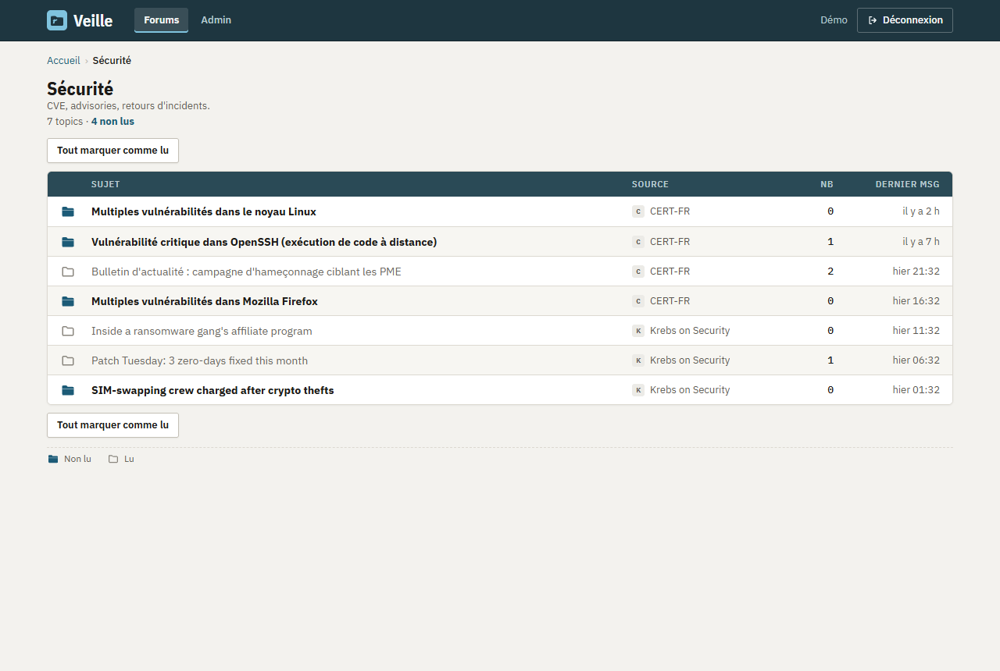
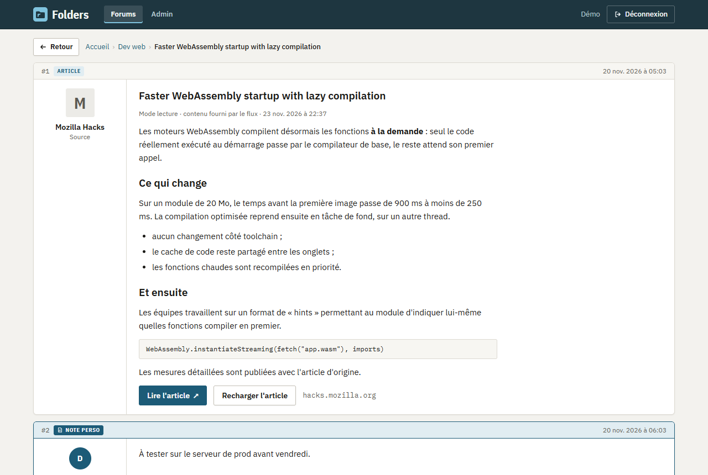

# Veille

[](https://github.com/louisdrouhin/veille/actions/workflows/ci.yml)
[](https://github.com/louisdrouhin/veille/actions/workflows/codeql.yml)
[](LICENSE)

Agrégateur de veille technique auto-hébergé, présenté comme un **forum des années 2000** : chaque source RSS / Atom
alimente un forum thématique, chaque article devient un topic, et on le lit directement dans l'app en mode lecture.
Application mono-utilisateur, pensée pour tourner chez soi en Docker Compose derrière un reverse proxy.


| Liste des topics | Mode lecture |
|---|---|
|  |  |


*Captures réalisées sur la base de démo (`npm run db:seed`).*

## Fonctionnalités

- **Forums et topics** : un tableau dense par forum (dossier plein = non lu), tri par dernière activité, pagination,
  « Tout marquer comme lu », compteurs de non-lus sur l'accueil.
- **Récupération des flux** par un worker séparé : ETag / If-Modified-Since, timeout, mise en pause automatique d'une
  source après 3 échecs, dédoublonnage par URL normalisée (sans `utm_*`, `fbclid`, fragment…).
- **Mode lecture** : l'article complet dans la page topic, depuis le contenu du flux ou extrait de la page d'origine
  avec Readability, HTML assaini, images servies par un proxy interne. Cache et ré-extraction à la demande.
- **Notes perso** sur chaque topic.
- **Double authentification (TOTP)** optionnelle, depuis « Mon compte » : QR code, codes de secours, appareil de confiance 30 jours.
- **Administration** : forums réordonnables par glisser-déposer, sources avec statut et dernière erreur,
  « Récupérer maintenant ».
- **Favicons des sources** téléchargés côté serveur, avec repli sur l'initiale.
- **Premier lancement guidé** (`/setup`) et scripts de création de compte et de récupération de mot de passe.
- **Supervision** : `/api/health` signale une base injoignable ou un worker arrêté (pour Uptime Kuma & co).

## Stack

| | |
|---|---|
| App | Next.js 16 (App Router, server actions, `proxy.ts`), React 19, TypeScript strict |
| UI | Tailwind CSS v4 (design tokens, aucune couleur en dur), polices IBM Plex auto-hébergées |
| Données | PostgreSQL 17, Drizzle ORM (migrations versionnées) |
| Auth | Better Auth (email + mot de passe, inscription désactivée) |
| Worker | Process Node séparé (`rss-parser`), même base de code |
| Lecture | `@mozilla/readability` sur un DOM `linkedom`, `sanitize-html` |
| Tests | Vitest, PGlite en mémoire, testcontainers (PostgreSQL réel) pour l'intégration |
| Déploiement | Docker (build Next `standalone`, utilisateur non-root), Docker Compose |
| CI | GitHub Actions (lint, typecheck, tests, intégration, `npm audit`), CodeQL, Dependabot ; actions épinglées par SHA |

## Choix de sécurité

L'app affiche du HTML venu de sites tiers et télécharge des URL qu'elle ne contrôle pas : la sécurité a guidé la
conception.

- **SSRF** (`lib/net/safe-fetch.ts`) : toutes les requêtes sortantes déclenchées par du contenu tiers (mode lecture,
  favicons, proxy d'images) passent par `safeFetch`. Seuls `http` et `https` sont acceptés ; le nom est résolu et
  toute adresse privée, loopback, link-local ou réservée est refusée (10/8, 172.16/12, 192.168/16, 127/8,
  169.254/16, 100.64/10, `::1`, `fc00::/7`, `fe80::/10`, IPv4 mappée…). La socket elle-même utilise un `lookup`
  filtré, donc pas de fenêtre de DNS rebinding entre la vérification et la connexion. Redirections suivies à la main
  (3 au maximum) et revérifiées à chaque saut ; taille maximale appliquée pendant le téléchargement.
- **Assainissement HTML** (`lib/reader/sanitize.ts`) : liste blanche stricte de balises (`p`, `h2`-`h4`, listes,
  `a`, `strong`, `em`, `blockquote`, `pre`/`code`, `img`, `figure`) et d'attributs (`a[href]`, `img[src|alt]`
  seulement : ni `on*`, ni `style`) ; liens externes en `rel="noopener noreferrer"`. Fait côté serveur, avant stockage.
  L'extraction tourne sur `linkedom`, qui n'exécute aucun script.
- **Images** : réécrites vers `/api/image-proxy` (session requise), types identifiés par leurs octets (SVG refusé),
  taille limitée. Le navigateur ne contacte jamais le site tiers.
- **CSP** (`lib/csp.ts`, posée par `proxy.ts` sur chaque page) : scripts `'nonce-…' 'strict-dynamic'` avec un nonce
  par requête, `img-src 'self'`, `object-src`, `frame-src` et `media-src` à `'none'`, `frame-ancestors 'none'`,
  `form-action 'self'`.
- **Authentification** : Better Auth, inscription désactivée, mots de passe ≥ 12 caractères, cookies `Secure` en
  HTTPS, double authentification TOTP optionnelle (secret chiffré en base, codes de secours à usage unique, verrouillage
  après 10 échecs). Rate limiting : 3 tentatives / 10 s par client sur la connexion et sur le second facteur.
  Le client est identifié par `X-Forwarded-For` uniquement (pas `X-Real-IP`, qu'un proxy qui ne le pose pas laisse
  passer tel quel) ; avec `TRUSTED_PROXIES`, par l'IP que le proxy a lui-même ajoutée en fin d'en-tête. `proxy.ts` ne sert qu'à une redirection de confort : chaque layout protégé, route API et server
  action revérifie la session côté serveur (cf. CVE-2025-29927). Le setup de premier lancement est protégé par
  `pg_advisory_xact_lock` (un seul compte peut être créé, testé avec des setups concurrents) puis renvoie 404.
- **Exploitation** : conteneur non-root, images de base épinglées par digest (mises à jour par Dependabot), healthcheck
  sans donnée utilisateur, secrets uniquement par variables d'environnement, rotation des logs Docker.

Une faille ? Voir [SECURITY.md](SECURITY.md).

## Installation (Docker Compose)

Prérequis : Docker avec le plugin Compose, et idéalement un reverse proxy HTTPS devant l'app.

```sh
git clone https://github.com/louisdrouhin/veille.git
cd veille
cp .env.example .env
```

Dans `.env`, renseigner au minimum :

- `POSTGRES_PASSWORD` : par exemple `openssl rand -base64 24` ;
- `BETTER_AUTH_SECRET` : au moins 32 caractères aléatoires, par exemple `openssl rand -base64 32` ;
- `BETTER_AUTH_URL` : l'URL publique exacte de l'app, telle que la voit le navigateur ;
- `APP_PORT` / `APP_BIND` : le port publié pour le reverse proxy (`APP_BIND=127.0.0.1` si le proxy est sur la même machine) ;
- `TRUSTED_PROXIES` (optionnel) : l'IP du reverse proxy, pour un rate limiting par client exact.

> Le port de l'app ne doit être joignable que par le reverse proxy (`APP_BIND`, pare-feu) : en accès direct, un client
> peut forger `X-Forwarded-For` et contourner le rate limiting de la connexion.

```sh
docker compose up -d --build
curl http://localhost:3000/api/health     # {"status":"ok",…} une fois le premier cycle du worker terminé
```

- `app` applique les migrations au démarrage puis sert Next ; `worker` démarre une fois `app` healthy ;
  `db` stocke ses données dans le volume `db-data`. Logs Docker limités à 3 × 10 Mo par service.
- Le reverse proxy doit transmettre l'en-tête `Host` d'origine (ou `X-Forwarded-Host`), sinon Next refuse les
  server actions (protection CSRF).

### Premier lancement : `/setup`

Tant qu'aucun compte n'existe, toutes les pages redirigent vers **`/setup`** : email, mot de passe (≥ 12 caractères)
et confirmation. Une fois le compte créé, `/setup` renvoie 404 définitivement.

> ⚠️ Tant que le setup n'est pas fait, quiconque atteint l'app peut le faire : crée le compte **avant** d'exposer
> l'app via le reverse proxy, ou en ligne de commande :

```sh
docker compose exec app node dist/create-user.js --email moi@example.com --password 'un long mot de passe' --name Moi
# Mot de passe oublié : change le mot de passe et ferme toutes les sessions (--disable-2fa : coupe aussi la 2FA)
docker compose exec app node dist/reset-password.js --email moi@example.com --password 'un nouveau mot de passe'
```

Ensuite : créer des forums et des sources dans **Admin**, puis « Récupérer maintenant » ou attendre le worker
(toutes les `FETCH_INTERVAL_MINUTES`, 15 par défaut).

### Supervision

`GET /api/health` (non authentifié, sans donnée utilisateur) :

```json
{"status":"ok","db":"ok","worker":{"status":"ok","lastCycleAt":"2026-11-23T09:13:44.171Z","intervalMinutes":15,"staleAfterMinutes":45}}
```

Réponse **503** si la base est injoignable, ou si le worker n'a terminé aucun cycle depuis plus de 3 × son intervalle
(`worker.status` : `stale`, ou `never` s'il n'a jamais tourné) : une sonde HTTP Uptime Kuma sur cette URL détecte un
worker planté. Le healthcheck Docker de `app` utilise `/api/health/app` (base seule), puisque le worker attend que
l'app soit healthy pour démarrer.

### Double authentification

À activer dans **Mon compte** (clic sur ton nom dans l'en-tête) : mot de passe, QR code à scanner, code de
confirmation ; note les codes de secours. Téléphone et codes de secours perdus :

```sh
docker compose exec app node dist/reset-password.js --email moi@example.com --password '…' --disable-2fa
```

Sauvegarde : `docker compose exec db pg_dump -U veille veille > veille.sql`.

## Développement

```sh
npm install
cp .env.example .env
npm run db:dev        # PostgreSQL embarqué (PGlite, données dans .pglite/) sur localhost:5432
```

Dans `.env` : `DATABASE_URL=postgres://postgres@localhost:5432/postgres` et `BETTER_AUTH_URL=http://localhost:3000`.
Puis, dans un autre terminal :

```sh
npm run db:migrate
npm run db:seed       # base de démo : forums, sources, topics, notes ; compte demo@veille.local / demo-veille-2026
npm run dev           # http://localhost:3000
npm run worker        # optionnel, dans un autre terminal (--once pour un seul cycle)
```

On peut aussi utiliser un vrai PostgreSQL :
`docker compose -f docker-compose.yml -f docker-compose.dev.yml up -d db`.

| Script | Rôle |
|---|---|
| `npm test` | Tests unitaires (normalisation d'URL, parsing RSS/Atom, anti-SSRF, assainissement, CSP, récupération sur PGlite) |
| `npm run test:integration` | Après `npm run build`. Setup de premier lancement sous concurrence et app réelle en HTTP ; workers concurrents sur un vrai PostgreSQL (testcontainers, ou `TEST_DATABASE_URL`) |
| `npm run lint` / `npm run typecheck` | ESLint (config Next + règles React Compiler) / TypeScript strict |
| `npm run db:generate` | Génère une migration après modification de `lib/db/schema.ts` |
| `npm run build` | Build Next standalone + bundles `dist/{worker,migrate,create-user,reset-password}.js` |

## Fonctionnement en détail

- **Worker** (`worker/index.ts`) : récupère les sources actives et non en pause, en parallèle
  (`FETCH_CONCURRENCY`). 3 échecs consécutifs : pause d'une heure, erreur visible dans l'admin. Insertion en
  `ON CONFLICT DO NOTHING` sur l'URL normalisée, donc le worker et « Récupérer maintenant » peuvent tourner en même temps.
- **Premier import** d'une source : les articles arrivent marqués comme lus. Une date absente, invalide ou future est
  remplacée par la date de récupération. Affichage en Europe/Paris.
- **Mode lecture** : le contenu du flux est utilisé s'il fait au moins 500 caractères de texte ; sinon la page est
  extraite à la première ouverture (rendu streamé). En cas d'échec (erreur HTTP, paywall, extraction trop courte) :
  message, extrait et lien d'origine ; l'échec est mis en cache 24 h. Cache `article_contents` purgé après 90 jours.
- **Favicons** : depuis le `<link rel="icon">` du site ou `/favicon.ico`, PNG / ICO / GIF / JPEG / WebP ≤ 100 Ko,
  rafraîchis tous les 7 jours, servis par `/api/favicon/[sourceId]`.
- **Suppressions** : supprimer une source conserve ses topics ; un forum non vide ne peut pas être supprimé.

## Documentation

- [`docs/SPEC.md`](docs/SPEC.md) : spécification et feuille de route (v2 : fusion multi-sources, Reddit, HN,
  GitHub ; v3 : recherche plein texte, raccourcis, mode sombre).
- [`docs/design/`](docs/design/) : brief de direction artistique (`HANDOFF.md`) et design tokens
  (`veille-tokens.css`, repris tel quel dans `app/globals.css`).

## Licence

[MIT](LICENSE). Polices IBM Plex sous licence SIL OFL 1.1 (`app/fonts/OFL-*.txt`).
